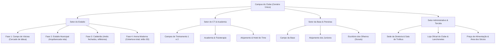

# Planejamento: Arena de Bairro no Estilo Age of Empires & SimCity
*Documento de Especificação Arquitetural e Design de Jogo — Cenário Único Contínuo*

---

## 1. Diagnóstico: Por que a versão atual ficou distante de Age of Empires / SimCity?

| Aspecto | Versão Atual (0.5) | Referência Age of Empires / SimCity |
| :--- | :--- | :--- |
| **Cenário** | Imagem raster 2D fixa no centro (`arena-cenario.png`) com retângulos geométricos de Canvas nos terrenos vizinhos. | **Mundo isométrico 100% contínuo em grid**, onde cada metro quadrado de chão, estrada e prédio pertence ao mesmo sistema de coordenadas. |
| **Construções** | Caixas desenhadas por código com cores sólidas (`worldPoly`). Obras são linhas amarelas cruzadas. | **Modelos/Sprites 3D isométricos com volume, luz, sombra e estágios físicos** (canteiro com andaimes, guindastes, estrutura subindo). |
| **Vida no Mapa** | 1 gerente controlado por joystick, 1 roupeiro e torcedores em fila reta pré-programada. | **Dezenas de agentes autônomos circulando** (estilo aldeões de AoE / cidadãos de SimCity): atletas correndo, torcida chegando por avenidas, ônibus do clube, jardineiros, ambulâncias. |
| **Interface (UI)** | Diálogos modais grandes (`<dialog>`) que cobrem a tela e pausam a ação do mundo. | **HUD integrada e não-obstrutiva**: você clica em um prédio e o painel de inspeção abre na lateral ou rodapé enquanto o mundo continua rodando ao fundo. |
| **Dinâmica do Jogo** | Foco quase exclusivo no gerente andando até o balcão pegar kits (estilo *Pizza Ready!*). | **Foco em planejamento urbano, fluxo logístico e expansão territorial** (estilo *SimCity* / *AoE* / *Copa City*). |

---

## 2. Visão Conceitual: O Campus do Clube em Cenário Único

O jogo se passa em um **único mapa isométrico expansível**. O jogador nunca sai dessa tela; todo o crescimento do clube — do campinho de várzea até o estádio de Champions League — acontece diante dos seus olhos.

```
       [ ZONA DO ESTÁDIO PRINCIPAL ]
             (Expandível: 1k -> 50k lugares)
                          |
    [ SEDE & NEGÓCIOS ] --+-- [ CENTRO DE TREINAMENTO & BASE ]
   (Diretoria, Loja,     |    (Campos 1 e 2, Alojamento,
    Imprensa, Museu)     |     Academia, Departamento Médico)
                          |
             [ ENTRADA DO CLUBE & TRANSPORTE ]
          (Avenida, Metrô, Estacionamento, Bares)
```

### O Duplo Ritmo do Jogo:
1. **Segunda a Sexta (Rotina & Operação — Estilo SimCity/AoE):**
   * Os atletas treinam no CT e na academia;
   * A categoria de base faz peneiras no campo anexo;
   * Equipes de obras constroem ou reformam setores do clube;
   * Caminhões de suprimentos abastecem o almoxarifado;
   * O jogador planeja reformas, contratações e expansão de terrenos.
2. **Dia de Partida (O Evento — Estilo Copa City):**
   * O mapa se transforma! Ônibus e metrô desembarcam caravanas de torcedores;
   * A rua em frente ao estádio vira uma praça de torcida com barracas e fumaça colorida;
   * Os refletores do estádio se acendem;
   * As catracas registram milhares de torcedores entrando;
   * O placar eletrônico gigante 3D no estádio mostra o jogo ao vivo acontecendo no centro do mapa.

---

## 3. Arquitetura Técnica: Motor Isométrico em Canvas

Para manter o jogo leve, rápido em qualquer celular e sem depender de bibliotecas pesadas, a engine recomendada é **Vanilla Canvas 2D Isométrico com Depth-Sorting (Y-Sorting)**.

### 3.1. Projeção e Coordenadas
Em vez de coordenadas cartesianas soltas, o mundo utiliza uma malha em diamante:
```javascript
// Conversão de Grid (tileX, tileY) para Tela (pixelX, pixelY)
const TILE_WIDTH = 64;   // Largura do losango
const TILE_HEIGHT = 32;  // Altura do losango

function gridToScreen(tileX, tileY) {
  return {
    x: (tileX - tileY) * (TILE_WIDTH / 2),
    y: (tileX + tileY) * (TILE_HEIGHT / 2)
  };
}

function screenToGrid(screenX, screenY) {
  return {
    x: Math.floor((screenX / (TILE_WIDTH / 2) + screenY / (TILE_HEIGHT / 2)) / 2),
    y: Math.floor((screenY / (TILE_HEIGHT / 2) - screenX / (TILE_WIDTH / 2)) / 2)
  };
}
```

### 3.2. Ordenação de Profundidade (Depth Sorting / Y-Sorting)
O segredo dos clássicos como *Age of Empires* e *SimCity 2000/3000*: personagens podem caminhar **na frente** e **atrás** de edifícios sem clipping.

```javascript
// Render Loop com Depth-Sorting
function renderIsometricWorld(ctx, tiles, entities) {
  // 1. Desenhar o chão (terreno, grama, estradas)
  drawTerrainGround(ctx, tiles);

  // 2. Coletar todas as entidades com altura (prédios, árvores, personagens)
  const renderQueue = [...buildings, ...characters, ...particles];

  // 3. Ordenar por profundidade (Y ou tileX + tileY)
  renderQueue.sort((a, b) => (a.tileX + a.tileY) - (b.tileX + b.tileY));

  // 4. Desenhar em ordem (Painter's Algorithm)
  for (const entity of renderQueue) {
    entity.draw(ctx);
  }
}
```

---

## 4. Pipeline de Arte: Como obter o 3D Isométrico Estilizado

Com base nos sites pesquisados (**Sketchfab, Kenney, KayKit, Rig Bake**), a melhor abordagem para gerar assets com visual profissional sem modelar tudo do zero:

```
[ Modelos 3D Low-Poly ]
(KayKit / Kenney / Sketchfab / Poly Pizza)
           │
           ▼
[ Pipeline de Renderização Isométrica ]
(Rig Bake / Blender script / Three.js Headless)
• Câmera ortográfica a 45° / 35.264°
• Luz suave com oclusão de ambiente (estilo Toy/Clay)
• Saída em 4 ou 8 direções
           │
           ▼
[ Sprite Sheet 2.5D com Atlas JSON ]
(PNG transparente, ultra-leve para celular)
           │
           ▼
[ Motor Canvas do Jogo ]
(Desenhado com 60 FPS direto no navegador)
```

---

## 5. Estrutura de Zonas e Construções do Clube

O campus é dividido em 4 setores que evoluem fisicamente:



---

## 6. Agentes Vivos no Mapa (O "Formigueiro" Estilo Age of Empires)

Para o jogo parecer uma simulação viva e não um cenário parado:

1. **Atletas do Elenco Profissional (11 a 20 jogadores):**
   * Caminham em grupo do vestiário para o CT no horário de treino;
   * Fazem circuitos de cones, finalizações na trave e alongamentos;
   * Entram no túnel do estádio em dia de jogo uniformizados.
2. **Jovens da Base (4 a 12 atletas):**
   * Treinam no campo anexo;
   * Olheiros ficam na beira do campo com pranchetas avaliando.
3. **Equipe Operacional (Aldeões do Clube):**
   * **Roupeiro / Logística:** leva caixas de uniformes e bolas da lavanderia aos campos.
   * **Jardineiro com tratorzinho:** cuida das faixas de grama.
   * **Operários da Construção:** quando uma obra é iniciada, eles montam andaimes, usam furadeiras/solda e colocam tijolos até o novo nível ser revelado.
4. **Torcida Dinâmica (Centenas de torcedores em dia de jogo):**
   * Chegam pela entrada sul do mapa;
   * Formam filas nas bilheterias e quiosques;
   * Sobem as escadas da arquibancada e reagem aos gols com bandeiras e fumaça.

---

## 7. Detalhamento das Fases Visuais de Cada Prédio

### 7.1. Estádio Principal (O Coração do Mapa)
| Fase | Nome | Visual Isométrico 3D | Capacidade | Benefício Econômico |
| :--- | :--- | :--- | :--- | :--- |
| **1** | Campo de Várzea | Terra batida/grama rala, traves de madeira, cerca de tábuas e 50 torcedores em pé na beira do campo. | 200 torcedores | R$ 5 por ingresso |
| **2** | Estádio Municipal | Gramado alinhado, arquibancada reta de concreto (1 lado), 2 catracas manuais e cabine de rádio simples. | 3.000 torcedores | R$ 15 por ingresso + R$ 500 patrocínio |
| **3** | Caldeirão de Bairro | Anel de arquibancada em ferradura, 4 torres de refletores metálicas com iluminação à noite, túnel inflável. | 15.000 torcedores | R$ 35 por ingresso + R$ 3.000 patrocínio |
| **4** | Arena Multiuso Elite | Cobertura metálica curva translúcida, telão 3D central giratório, camarotes envidraçados, placar de LED. | 45.000 torcedores | R$ 75 por ingresso + R$ 15.000 patrocínio |

### 7.2. Centro de Treinamento (CT)
* **Fase 1:** Campinho auxiliar com cones de plástico e uma barra de ferro para flexão.
* **Fase 2:** Campo demarcado, galpão pré-moldado com esteiras e pesos visíveis pelas janelas.
* **Fase 3:** Dois campos com grama sintética padrão FIFA, piscina de gelo para fisioterapia e sala de vídeo.
* **Fase 4:** Complexo de alta performance com hotel de concentração, pista de atletismo ao redor e heliponto.

### 7.3. Sede & Praça Social
* **Fase 1:** Barraca de cachorro-quente e um contêiner administrativo com a bandeira do clube.
* **Fase 2:** Prédio de 1 andar de tijolinho, 3 quiosques de comida e mesa de bilhar dos sócios.
* **Fase 3:** Sede com 2 andares, loja oficial de camisas com vitrine iluminada e museu dos primeiros troféus.
* **Fase 4:** Edifício executivo com auditório de imprensa, restaurante panorâmico e praça com estátua do maior artilheiro.

---

## 8. Interface do Usuário (HUD Lateral Estilo SimCity)

Diferente da versão atual com diálogos modais (`showModal()`) que cobrem todo o jogo, a nova interface adota o **estilo gaveta lateral (Inspector Drawer)**:

```
+--------------------------------------------------------+-------------------+
|  [Escudo] CLUBE DA VILA    R$ 48.250     DIVISÃO: B    | INSPECTOR (CT)    |
+--------------------------------------------------------+                   |
|                                                        | [Icone 3D do CT]  |
|                                                        | Nível: Fase 2     |
|              ( MAPA ISOMÉTRICO AO VIVO )               |                   |
|                                                        | "Evolução do time |
|      [Estádio]                 [CT em Obras]           |  acelera em +30%" |
|                                                        |                   |
|                                                        | [Melhorar: 12.000]|
|          [Atletas correndo]                            | [Ver Atletas]     |
|                                                        |                   |
|                                                        |                   |
+--------------------------------------------------------+                   |
|  [Minimapa]  | [Construir] [Treino] [Elenco] [Partida] | [Fechar X]        |
+--------------------------------------------------------+-------------------+
```
* Ao clicar no estádio, CT ou sede, o painel abre na lateral direita **sem pausar a simulação**.
* O jogador pode continuar vendo os atletas se exercitando e a multidão se movimentando enquanto gerencia contratos e finanças.

---

## 9. Protótipo Interativo Criado

Foi criado na raiz do projeto o arquivo executável:
👉 **[`demo-isometrico.html`](file:///d:/Meu%20Drive/Bilder%20Ai/jogo_bernardo/demo-isometrico.html)**

Abra este arquivo no navegador para ver o conceito funcionando na prática:
* Grid diamante isométrico com renderização contínua;
* Algoritmo de **Y-Sorting**: ande com o Gerente (<kbd>W</kbd><kbd>A</kbd><kbd>S</kbd><kbd>D</kbd>) para frente e para trás do Estádio e do CT e observe a oclusão tridimensional natural;
* Atletas do clube correndo em círculo no pátio e torcedores caminhando pela calçada;
* Câmera livre com Pan (arrastar) e Zoom (scroll do mouse).
